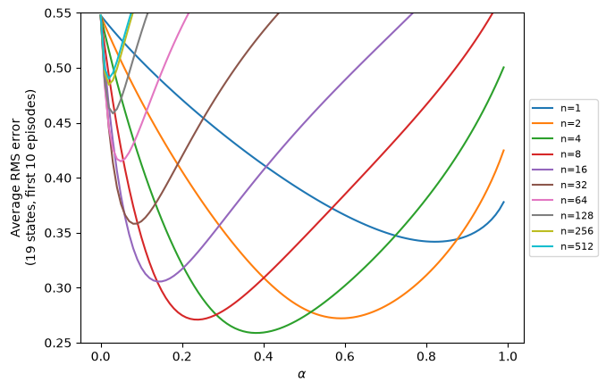

# sutton-barto-rl

Solutions to the programming exercises in Sutton & Barto,
*Reinforcement Learning: An Introduction* (2nd ed.), written from scratch in NumPy and PyTorch.
Covers every programming exercise in Chapters 2–6, plus a reproduction of Figure 7.2.

| | Exercise | |
|---|---|---|
| 2 Bandits | [2.5](ch02-bandits/exercise-2-5.py) | Sample averages vs. constant step size on a nonstationary 10-armed testbed |
| | [2.11](ch02-bandits/exercise-2-11.py) | Parameter study for the nonstationary case (cf. Fig. 2.6) |
| 4 Dynamic programming | [4.7](ch04-DP/exercise-4-7.py) | Policy iteration on the modified Jack's car rental |
| | [4.9](ch04-DP/exercise-4-9.py) | Value iteration on the gambler's problem |
| 5 Monte Carlo | [5.12](ch05-MonteCarlo/exercise-5-12.py) | Off-policy MC control on the racetrack |
| 6 TD learning | [Ex. 6.5](ch06-TD/example-6-5.py), [6.9](ch06-TD/exercise-6-9.py), [6.10](ch06-TD/exercise-6-10.py) | Sarsa on the windy gridworld: king's moves, stochastic wind |
| 7 *n*-step | [Fig. 7.2](ch07-n-step-bootstrapping/figure-7-2.py) | *n*-step TD on the 19-state random walk, all (α, n, run) settings as one batched tensor |

Run with [uv](https://docs.astral.sh/uv/): `uv run <path>`.
